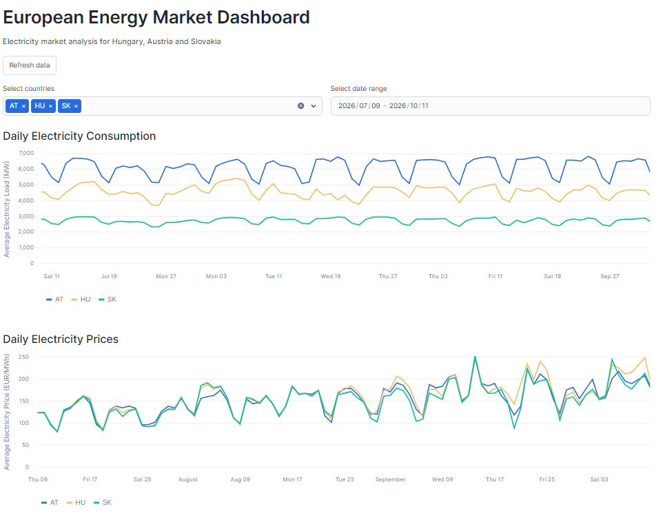
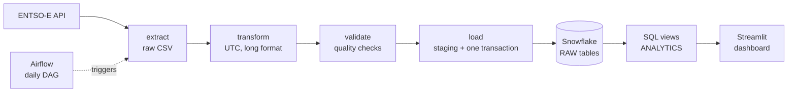
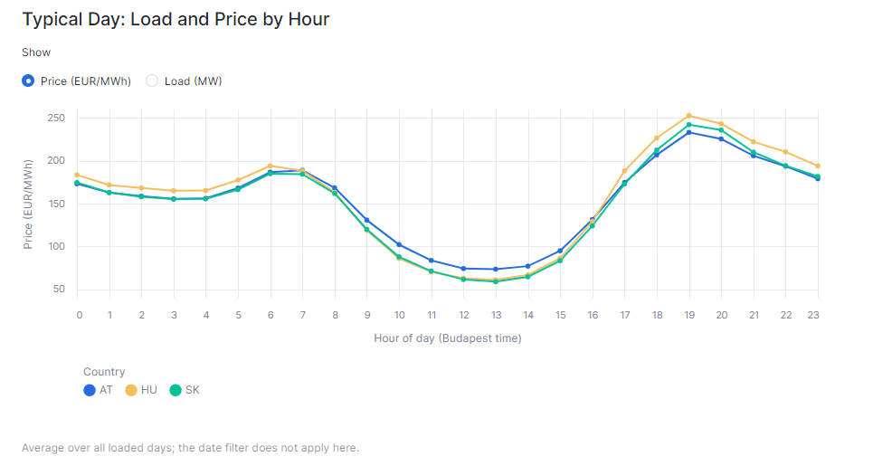
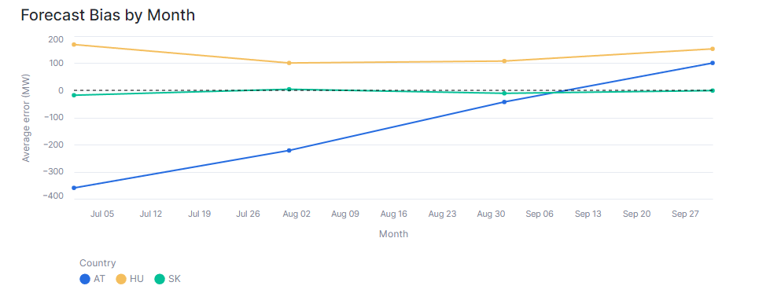
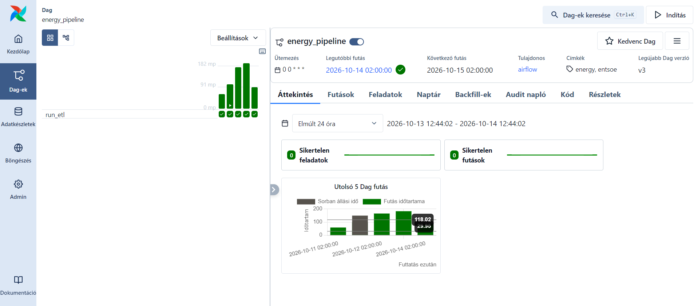

# European Electricity Data Pipeline

A daily batch pipeline that pulls electricity market data for **Hungary, Austria and Slovakia** from the [ENTSO-E Transparency Platform](https://transparency.entsoe.eu/), validates it, loads it into **Snowflake**, and serves analytics through **SQL views** and a **Streamlit dashboard**. It is orchestrated with **Airflow**, packaged with **Docker** and covered by automated tests.



**What it can answer**

- How accurate are the official day-ahead load forecasts, and are they biased?
- What does a typical day look like for load and prices, hour by hour?
- How do daily prices relate to demand and to the renewable share of generation?

---

## Architecture



For one calendar day, `run_pipeline.py` does the following for each dataset: **extract → transform → validate**. Only when all four datasets pass does it **load** them into Snowflake, in a single transaction.

| Dataset | ENTSO-E query | Snowflake table | Resolution |
|---|---|---|---|
| Actual load | `query_load` | `RAW.LOAD` | 15 min |
| Day-ahead load forecast | `query_load_forecast` | `RAW.LOAD_FORECAST` | 15 min |
| Generation by source | `query_generation` | `RAW.GENERATION` | 15 min |
| Day-ahead prices | `query_day_ahead_prices` | `RAW.DAY_AHEAD_PRICES` | 15 min |

The history was backfilled for 90 days (9 July to 6 October 2026), and the Airflow DAG then keeps it up to date.

## Tech stack

Python 3.13 (pandas, entsoe-py) · Snowflake (SQL, Snowpark, Streamlit in Snowflake) · Apache Airflow 3.1 · Docker and Docker Compose · pytest · SQL views for analytics

---

## Dashboard

| Typical day: price and load by hour | Forecast bias by month |
|---|---|
|  |  |

The app (`dashboard/streamlit_app.py`) runs inside Snowflake, so it needs no credentials of its own. Queries are cached for an hour. It shows consumption, prices, generation mix, actual vs forecast load, forecast bias, the hourly profile and price vs consumption.

## Orchestration



The DAG `energy_pipeline` runs daily. It processes the date **three days back**, to give ENTSO-E time to publish complete data, and retries three times, two hours apart. A day is only loaded if every dataset passes validation, so a failed run leaves Snowflake unchanged.

---

## Findings

These are descriptive results from the 90-day backfill, not explanations.

**1. Prices follow the sun.** Average day-ahead prices fall to roughly 60 to 70 EUR/MWh around midday and peak at roughly 230 to 250 EUR/MWh at 19:00, in all three countries, even though demand is also high at midday.

**2. The official load forecast is biased, and the bias differs by country.** Average error is actual minus forecast (negative means the forecast was too high):

| Country | Jul | Aug | Sep | Oct (partial) |
|---|---|---|---|---|
| AT | -360 MW | -222 MW | -43 MW | -14 MW |
| HU | +169 MW | +101 MW | +108 MW | +162 MW |
| SK | -18 MW | +4 MW | -11 MW | -9 MW |

Austria's forecast overestimated demand early in the period and the bias then faded. Hungary's forecast was too low in every month. Slovakia's was roughly unbiased. All of the ten worst country-days (by relative error) were Austrian, between 20 July and 14 August, with errors up to 905 MW (15.5 %). I have not established the cause.

**3. Prices vs demand and renewables** (daily averages, Pearson correlation):

| Country | Price vs renewable share | Price vs load |
|---|---|---|
| AT | 0.73 | 0.70 |
| HU | 0.40 | 0.51 |
| SK | 0.06 | 0.60 |

Correlation is not causation: season, temperature and fuel prices move demand and renewables together, and these markets are coupled to their neighbours.

**Classification choices.** "Renewable" means biomass, geothermal, hydro (run-of-river and reservoir), solar, wind and other renewable. Pumped storage and waste are deliberately left out, and the mapping lives in one table (`ANALYTICS.ENERGY_SOURCE_CATEGORY`).

---

## Quick start

### Prerequisites

- Python 3.12 or newer, and Docker (for the containers)
- A Snowflake account
- A free ENTSO-E API token (request one via the Transparency Platform)

### 1. Install

```bash
git clone <https://github.com/kovacsbence040518/entsoe-energy-pipeline>
cd EnergyDataPipeLine
python -m venv .venv
.venv\Scripts\activate            # Windows; on Linux/macOS: source .venv/bin/activate
pip install -r requirements-dev.txt
```

### 2. Configure

Copy `.env.example` to `.env` and fill in the values:

```
ENTSOE_API_KEY=
SNOWFLAKE_ACCOUNT=         # ORGNAME-ACCOUNTNAME
SNOWFLAKE_USER=
SNOWFLAKE_PASSWORD=
SNOWFLAKE_WAREHOUSE=ENERGY_WH
SNOWFLAKE_DATABASE=ENERGY_DB
SNOWFLAKE_SCHEMA=RAW
```

`.env` is git-ignored. Check the connection with `python scripts/check_snowflake_connection.py`.

### 3. Create the Snowflake objects

Run `sql/01_setup.sql` and then `sql/02_view.sql` in a Snowflake worksheet. They create the warehouse (X-Small, 60 s auto-suspend), the database, the `RAW` and `ANALYTICS` schemas, the tables, the source-to-category mapping and all analytics views.

### 4. Run the pipeline for one day

```bash
python src/run_pipeline.py --date 2026-10-01
```

Re-running the same date is safe: the loader replaces that day instead of appending to it.

### 5. Run it in Docker

```bash
docker build -t entsoe-pipeline .
docker run --rm --env-file .env entsoe-pipeline --date 2026-10-01
```

### 6. Run Airflow

```bash
docker compose up --build
```

Open <http://localhost:8080>. On first start, the admin password is printed in the container logs (`docker compose logs airflow`). Trigger or unpause the `energy_pipeline` DAG.

### 7. Backfill a date range (PowerShell)

```powershell
$start = Get-Date "2026-07-09"
0..89 | ForEach-Object {
    $d = $start.AddDays($_).ToString("yyyy-MM-dd")
    python src/run_pipeline.py --date $d
}
```

Each date is a separate run, so one failing day does not stop the others.

### 8. Run the tests

```bash
pytest
```

---

## Design decisions

| Decision | Why | What would go wrong otherwise |
|---|---|---|
| **Idempotent load**: delete the day, insert the day | Airflow retries and manual reruns are normal | Every rerun appends duplicates, and averages and counts become silently wrong |
| **All-or-nothing load**: stage all four datasets, then one transaction | A day should never be half loaded | Load data without prices, so joined views drop the day without any error |
| **Validate before load** | Bad data is cheaper to stop at the door than to clean in the warehouse | A missing country or layout change reaches the dashboards |
| **Timestamps in UTC, days in Budapest time** | HU, AT and SK share the time zone, and a "day" must match the local calendar | Wrong windows on the 23-hour and 25-hour days when the clocks change |
| **Config-driven datasets** (`config.py`) | Extract, transform, validate and load share one code path | Copy-pasted scripts that drift apart (it was 12 files before the refactor) |
| **Negative prices are valid** | They occur when supply exceeds demand | Real market events are rejected as errors |
| **Gaps fail the run, except for generation** | A missing quarter-hour distorts averages, while some generation series are legitimately incomplete | Silent bias in the analytics, or a pipeline that fails on harmless gaps |
| **One mapping table for energy sources** | The renewable list was copied into several views and a typo hid in one | Different views disagree about what counts as renewable |

### Problems the checks caught

- Hungary's generation file arrived with a **different layout** (a single header row) on 7 October 2026. The transform now handles both layouts, with a regression test.
- The day-ahead prices query returned an **extra boundary row** (97 instead of 96 rows per country). Rows outside the requested day are now dropped.
- `write_pandas` without `use_logical_type=True` mis-stored timezone-aware timestamps, so the delete step found nothing and **rows were silently duplicated**. The loader now sets it, and a test covers it.
- Slovakia's generation data had missing quarter-hour intervals on 2026-09-08, which the interval check reports (see `sql/03_checks.sql`).

---

## Testing

`pytest` runs 51 unit tests that need no credentials:

- **extract**: end-of-window handling, Series to DataFrame conversion for prices
- **transform**: both generation file layouts, UTC conversion, negative prices
- **validate**: required columns, duplicates, value ranges, expected countries, interval completeness on normal and 23/25-hour days
- **load** (mocked Snowflake): the order of operations, rollback on any failure, all datasets in one transaction, nothing touched when a CSV is bad, DST day boundaries

`tests/integration_test_snowflake.py` is a manual test against the real account. It only runs in the `ETL_TEST` schema, refuses to run anywhere else, and cleans up after itself. The SQL end-to-end check for one day is in `sql/06_e2e_test.sql`.

---

## Repository structure

```
EnergyDataPipeLine/
├── src/
│   ├── config.py            # countries, paths, per-dataset settings
│   ├── extract.py           # ENTSO-E API -> raw CSV
│   ├── transform.py         # raw CSV -> clean, UTC, long format
│   ├── validate.py          # data quality checks
│   ├── snowflake_load.py    # staging tables + single transaction
│   └── run_pipeline.py      # entry point: --date YYYY-MM-DD
├── airflow/dags/            # daily DAG
├── dashboard/               # Streamlit in Snowflake app
├── sql/                     # setup, views, checks, analysis, end-to-end test
├── tests/                   # unit tests + manual integration test
├── scripts/                 # connection check
├── docs/images/             # screenshots used in this README
├── Dockerfile               # pipeline image
├── Dockerfile.airflow       # Airflow image
├── compose.yaml
├── requirements.txt
├── requirements-dev.txt
└── pytest.ini
```

## Limitations

- Three countries and four datasets, at 15-minute resolution.
- Airflow runs locally in Docker, so it only runs while Docker is running.
- Password authentication is used, and key-pair authentication would be the better choice for production.
- The Snowflake account is a trial. The code, SQL, screenshots and a demo recording are kept in this repository, and the project can be pointed at a different account via `.env`.
- Findings are descriptive. I did not model or explain the forecast bias.

## Possible next steps

- Key-pair authentication and a Snowflake resource monitor
- One Airflow task per step (extract, transform, validate, load) for finer retries
- A transformation layer with dbt
- Time-series backtesting of a model against the official forecast
- More countries and a lakehouse version of the same pipeline

## Data source

Market data from the ENTSO-E Transparency Platform. Check their terms of use before redistributing data. Raw and processed files are git-ignored and not part of this repository.
